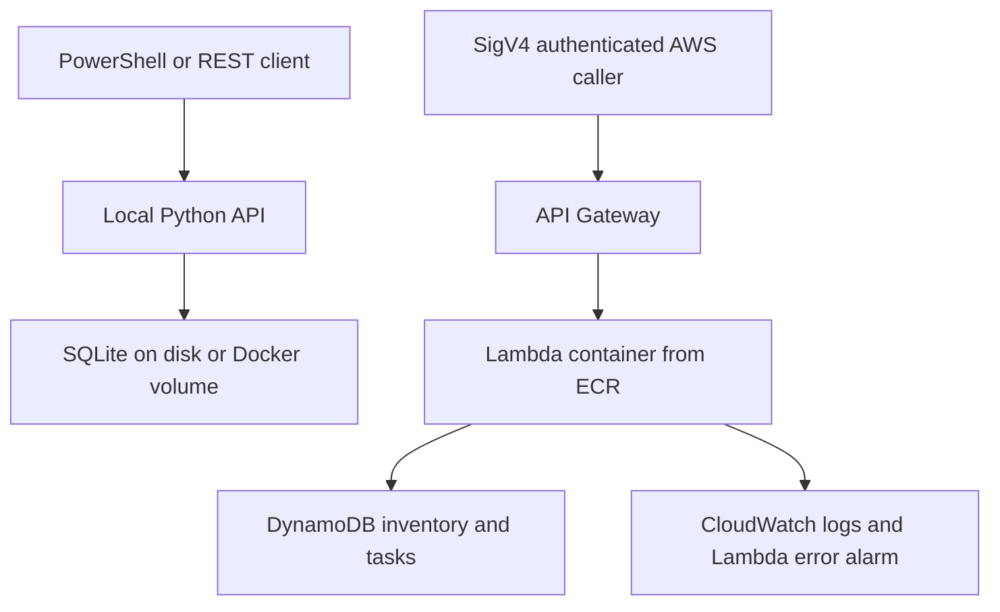

# CloudOps Task API

A personal asset inventory and maintenance-task API for my software and cloud projects, including Dani WebWorks. I use it locally to register asset references, create linked operational tasks, list pending work, and record task progress.

For example, the Dani WebWorks public website can be registered as an asset and linked to a task to review its availability. The API records the work; the actual website or security review is performed separately. A local integration test has exercised this workflow using the real public website reference.

**Stack:** Python 3.12, Docker, SQLite, Terraform, AWS Lambda, API Gateway, DynamoDB, ECR, IAM, CloudWatch, and GitHub Actions.

## Connect to existing AWS services

An optional host-side importer reads existing CloudFront, Lightsail, DynamoDB, Lambda and S3 inventory metadata using a local AWS profile; S3 discovery is opt-in. It stores only pseudonymous asset labels in the local API, not raw AWS resource names, account IDs, ARNs, domains or credentials.

This mode does not deploy the Terraform stack or create AWS infrastructure. Read-only calls are not universally free: review service API pricing. Live reports supplied by the owner verify CloudFront, DynamoDB and Lambda metadata queries and S3 discovery. Bucket configuration queries are partially blocked by IAM permissions; the report preserves AccessDenied rather than claiming successful inspection. See [connection, permissions, costs and privacy](docs/AWS_CONNECTION.md).

```bash
python -m pip install -r requirements-aws.txt
python scripts/import_aws.py --profile YOUR_PROFILE --region YOUR_REGION --limit 10
# With the local API running, explicitly save sanitized assets:
python scripts/import_aws.py --profile YOUR_PROFILE --region YOUR_REGION --limit 10 --import-local
```

## What is an asset?

An asset is a manually registered resource or component that I maintain: a website, an application API, a storage bucket, a distribution, or a database. Records contain a name, service, project, environment, and optional reference. References are labels or URLs, not credentials.

Manually registering an asset does not verify ownership, discover cloud resources, scan for vulnerabilities, or execute maintenance. The separate optional importer discovers resource identifiers through read-only SDK calls. This is a single-owner inventory, not a CNAPP, monitoring platform, or automated security scanner.

## Architecture



Terraform defines the AWS infrastructure. Local execution uses SQLite, while the optional AWS deployment uses DynamoDB. These are separate databases: deployment does not migrate local records automatically.

## Start locally

Requires Python 3.12+ or Docker Desktop in Linux-container mode. Run commands from the repository root.

### Python

```bash
python -m unittest discover -s tests -v
python scripts/smoke_test.py
python -m app.local
```

Records are saved to `data/cloudops.db` and survive process restarts. The smoke test uses its own temporary database and removes it after the test.

### Docker

Stop any Python instance using port 8080, start Docker Desktop, then run:

```bash
docker compose up --build
```

From another terminal:

```bash
docker ps
```

SQLite is saved to the named volume `cloudops-data`. `docker compose down` preserves it; `docker compose down -v` deletes it. Python and Docker use separate local storage unless explicitly configured otherwise.

The local service is exposed only on `127.0.0.1:8080` and has no authentication. Keep it on your development machine. For remote use, add authentication and TLS or use the IAM-protected AWS deployment.

## Try a real personal asset

With the API running, open another PowerShell terminal at the repository root:

```powershell
.\scripts\try_real_asset.ps1
```

The script registers the public Dani WebWorks website and creates an OPEN review task. It only calls localhost; it does not contact the website or AWS. Repeating it creates additional records, since names are not unique.

Equivalent commands you can adapt to your own assets:

```powershell
$base = 'http://localhost:8080'
Invoke-RestMethod "$base/health"

$assetBody = @{
    name = 'Dani WebWorks public website'
    service = 'Website'
    project = 'Dani WebWorks'
    reference = 'https://daniwebworks.com'
    environment = 'personal-business'
} | ConvertTo-Json
$asset = Invoke-RestMethod -Uri "$base/assets" -Method Post -ContentType 'application/json' -Body $assetBody

$taskBody = @{
    title = 'Review website availability and document the result'
    asset_id = $asset.id
    priority = 'medium'
} | ConvertTo-Json
$task = Invoke-RestMethod -Uri "$base/tasks" -Method Post -ContentType 'application/json' -Body $taskBody

Invoke-RestMethod "$base/assets" | ConvertTo-Json -Depth 5
Invoke-RestMethod "$base/tasks" | ConvertTo-Json -Depth 5

Invoke-RestMethod -Uri "$base/tasks/$($task.id)" -Method Patch -ContentType 'application/json' -Body '{"status":"in_progress"}'
```

Perform the maintenance review separately. Only after you actually finish it:

```powershell
Invoke-RestMethod -Uri "$base/tasks/$($task.id)" -Method Patch -ContentType 'application/json' -Body '{"status":"done"}'
```

To verify persistence, keep the returned IDs, restart the application, and retrieve the same records:

```powershell
Invoke-RestMethod "$base/assets/$($asset.id)"
Invoke-RestMethod "$base/tasks/$($task.id)"
```

IDs can also be recovered from the list endpoints if your PowerShell variables were lost.

## API reference

| Route | Purpose |
| --- | --- |
| `GET /health` | Process health; does not probe the database |
| `POST /assets` | Register an asset; requires name, service, project |
| `GET /assets` | List a page of assets |
| `GET /assets/{id}` | Retrieve one asset |
| `POST /tasks` | Create a task; requires title; optional asset_id and priority |
| `GET /tasks` | List a page of tasks |
| `GET /tasks/{id}` | Retrieve one task |
| `PATCH /tasks/{id}` | Change status to open, in_progress, or done |

List responses contain `items` and `next_cursor`. Use `?limit=25&cursor=RETURNED_CURSOR` to continue; stop only when `next_cursor` is null. Limits range from 1 to 100. DynamoDB Scan applies its limit before filtering, so a page may contain fewer items, or zero items, and still have a continuation cursor. SQLite pages sort by UUID; AWS scan order is unspecified.

Task titles and asset names must contain 1–120 characters after trimming. Priorities are low, medium, or high. Asset-linked tasks require an existing asset. Request bodies are limited to 16 KiB. Task updates accept only the status field.

Missing records return 404, invalid data returns 400, and unexpected errors return a sanitized 500. API records are manually entered; keep secrets and sensitive identifiers out of public examples and screenshots.

## Repository layout

- `app/handler.py`: shared validation and API routes.
- `app/storage.py`: SQLite and DynamoDB storage implementations.
- `app/local.py`: local HTTP adapter.
- `tests/`: 29 tests covering relationships, persistence, pagination, updates, and error handling.
- `scripts/import_aws.py`: manual read-only SDK discovery with HMAC asset aliases.
- `scripts/export_aws_report.py`, `export_storage_report.py`, `export_lambda_report.py`: selected live configuration reports.
- `scripts/combine_reports.py`: combines all three sanitized report files.
- `scripts/check_public_files.py`: checks tracked paths and common credential patterns.
- `scripts/docker_smoke.py`: CI check for Compose workflow and volume persistence after container recreation.
- `policies/`: limited read-only IAM policy examples.
- `scripts/smoke_test.py`: HTTP test that restarts the process and verifies persistence.
- `scripts/try_real_asset.ps1`: interactive local workflow using the Dani WebWorks website reference.
- `infra/registry/`: ECR bootstrap infrastructure.
- `infra/service/`: Lambda, API Gateway, DynamoDB, IAM, logs, and alarm.
- `docs/`: verification evidence and screenshots.
- `.github/workflows/ci.yml`: Python tests, HTTP smoke test, Terraform validation, and image builds.

## Live AWS evidence

[View the consolidated inventory report](docs/evidence/aws-inventory-report.txt).

The included source snapshots report:

| Service | Observed records | Verification scope |
| --- | --- | --- |
| CloudFront | 3 | Live configuration and approved public domain aliases |
| DynamoDB | 10 | Table configuration in us-east-1; capped at 10 results |
| S3 | 8 | Bucket discovery; region, versioning and public-access-block reads returned AccessDenied |
| Lambda | 3 | Function metadata in us-east-1; no invocations |

Counts describe the supplied snapshots, not a guaranteed complete inventory. Original AWS query timestamps are retained. The consolidated file combines existing snapshots and does not refresh them.

The approved public domains intentionally disclose the association with Dani WebWorks. Other names and resource identifiers are represented by keyed aliases. Local UUIDs identify inventory records only. Detailed configuration is intentionally public; this is not an absolute anonymity guarantee.

[Local HTTP integration evidence](docs/local-integration-evidence.md) separately documents asset/task behavior and SQLite persistence. No AWS calls were made by that test. See [validation](VALIDATION.md) and the [publication review](PUBLICATION_REVIEW.md) for remaining checks.

Original desktop screenshots were excluded from the public package because they expose the local Windows username and directory. New sanitized screenshots can be added separately.

To refresh and combine the report files, follow [AWS connection instructions](docs/AWS_CONNECTION.md). The export scripts keep sensitive source fields out of the TXT output.

## Optional AWS deployment

Uploading this repository to GitHub does not provision anything. Running the following steps provisions billable resources. Free-tier eligibility is not assumed. Requires Terraform >=1.6,<2, Docker Buildx, AWS CLI, and an AWS profile with provisioning permissions. Use a sandbox account. The Lambda reserved concurrency of 2 requires sufficient available account concurrency.

Commands below use Bash (Git Bash on Windows). Use the same region for ECR and Lambda. The repository name is fixed; use an isolated account/region or rename resources for multiple installations.

1. Provision the registry first; this avoids creating a Lambda before its image exists:

```bash
aws sts get-caller-identity
terraform -chdir=infra/registry init
terraform -chdir=infra/registry plan
terraform -chdir=infra/registry apply
REPO=$(terraform -chdir=infra/registry output -raw repository_url)
aws ecr get-login-password --region us-east-1 | docker login --username AWS --password-stdin "${REPO%%/*}"
docker buildx build --platform linux/amd64 --provenance=false --load -t "$REPO:v1" .
docker push "$REPO:v1"
DIGEST=$(aws ecr describe-images --region us-east-1 --repository-name cloudops-task-api --image-ids imageTag=v1 --query 'imageDetails[0].imageDigest' --output text)
```

2. Supply the digest to the service root, review the plan and deploy:

```bash
terraform -chdir=infra/service init
terraform -chdir=infra/service plan -var="image_uri=$REPO@$DIGEST" -out=deployment.tfplan
terraform -chdir=infra/service apply deployment.tfplan
terraform -chdir=infra/service output -raw api_url
```

For subsequent changes, use a new tag (`v2`, etc.), push, resolve its digest and repeat the service plan/apply. Immutable tags intentionally reject replacing `v1`.

3. Test the AWS endpoint using a SigV4-capable client such as Postman (AWS Signature authorization, service `execute-api`, correct region, temporary session token if applicable). The calling IAM identity needs `execute-api:Invoke` for the API stage/routes. An unsigned request should receive 403. Repeat create/get and inspect `/aws/lambda/cloudops-task-api` in CloudWatch.

The alarm monitors the Lambda Errors metric and has no notification destination configured. Handled API 500 responses do not increment Lambda's Errors metric. Add a custom application-error metric and SNS before using this for operational alerting.

4. Clean up after testing. These commands DELETE the demo tasks and all repository images:

```bash
terraform -chdir=infra/service destroy -var="image_uri=$REPO@$DIGEST"
aws ecr batch-delete-image --region us-east-1 --repository-name cloudops-task-api --image-ids "$(aws ecr list-images --region us-east-1 --repository-name cloudops-task-api --query 'imageIds' --output json)"
terraform -chdir=infra/registry destroy
```

The image deletion command covers a small demo repository. If more than 100 images exist, remove them in batches using the console or CLI. Never delete images still used by a function.

## Engineering decisions and limits

- SQLite provides lightweight local persistence without extra infrastructure. The named Docker volume keeps its database across container recreation; deleting the volume deletes its data.
- DynamoDB stores assets and tasks in one table using UUID keys and a kind field. Paginated Scan is intentionally simple for a small personal inventory. At scale, replace scans with keyed access patterns and indexes.
- Task creation validates the referenced asset. Asset deletion is not implemented. Task updates use a conditional DynamoDB update so missing tasks are not silently created.
- Runtime IAM permissions are scoped to the inventory table: GetItem, PutItem, Scan, and UpdateItem. Log writes are scoped to the function log group. The table remains named cloudops-tasks for compatibility with the earlier Terraform configuration.
- Terraform state is local. Use an encrypted remote backend and locking for team use. Keep state, plans, databases, credentials, and private asset exports out of Git.
- AWS routes require IAM authentication. The Lambda image, Terraform schema, and AWS integration still need independent verification for this release.
- The CloudWatch alarm monitors Lambda Errors. Handled HTTP 500 responses are not covered, and no notification action is configured. Add application-error metrics and a notification destination before relying on it operationally.
- CI is configured for tests, validation and builds, not automatic deployment. Review the actual Actions run before claiming it passed.
- No UI, user accounts, scheduled discovery, vulnerability scanning, or direct maintenance execution is included. There is no historical audit trail or task notes field; status stores the current value only.
- Base-image tags and the SDK supplied by the Lambda image are not pinned to immutable dependency versions. Pin digests and dependencies and add scanning for production releases.

## Verification status

| Check | Result |
| --- | --- |
| API, importer, report and publication unit tests | 29 passed |
| Updated local HTTP workflow | Passed: asset, linked tasks, pagination and updates |
| Updated SQLite persistence | Passed across process restart |
| Terraform formatting | Passed |
| Earlier task-only Docker version | Previously verified by owner; original screenshots omitted from public package |
| Updated Docker image and volume | Pending verification on the user's Docker installation |
| Lambda image build | Pending |
| Terraform schema validation | Pending; earlier environment could not start provider |
| GitHub Actions | Pending confirmation |
| Optional Terraform AWS deployment | Not performed |
| Read-only AWS discovery | Owner snapshots verify CloudFront, DynamoDB, S3 and Lambda |
| S3 configuration reads | AccessDenied in supplied snapshot; still pending |
| Report combination and basic publication check | Passed |

## Publication

Follow [Getting started](START_HERE.md) and [Publication review](PUBLICATION_REVIEW.md). Never commit the private alias key or local databases.

## Next improvements

Add project-specific indexes, structured maintenance notes and audit history, database backup procedures, and authenticated access for any shared deployment.

## References

- [Lambda Python container images](https://docs.aws.amazon.com/lambda/latest/dg/python-image.html)
- [Terraform Lambda resource](https://registry.terraform.io/providers/hashicorp/aws/latest/docs/resources/lambda_function)
- [API Gateway IAM authorization](https://docs.aws.amazon.com/apigateway/latest/developerguide/http-api-access-control-iam.html)
- [DynamoDB Scan pagination](https://docs.aws.amazon.com/amazondynamodb/latest/APIReference/API_Scan.html)
- [Docker Compose volumes](https://docs.docker.com/reference/compose-file/volumes/)
